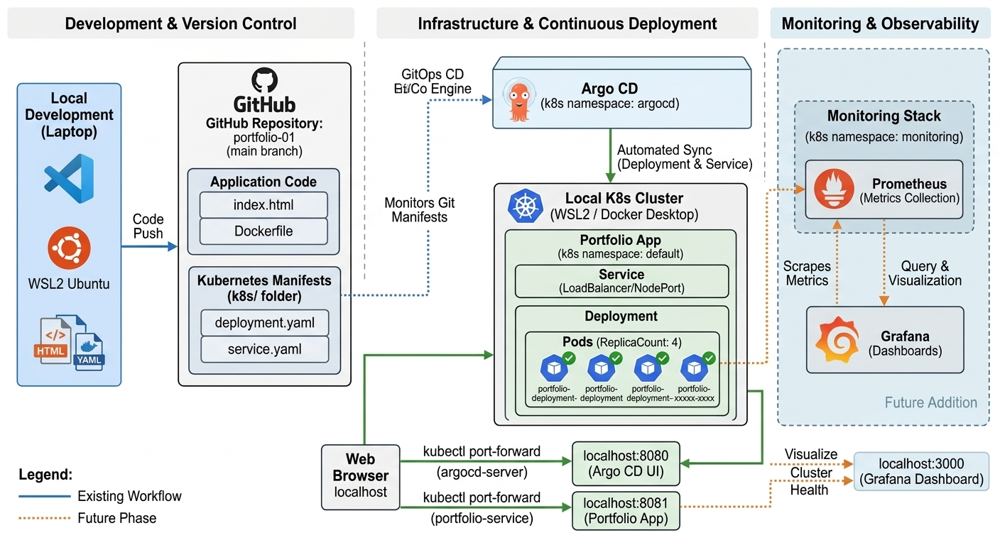
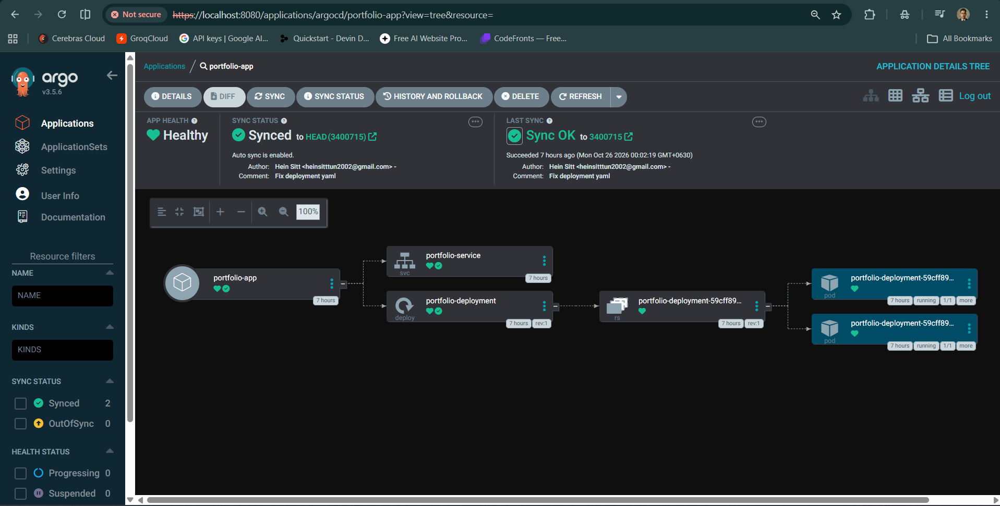
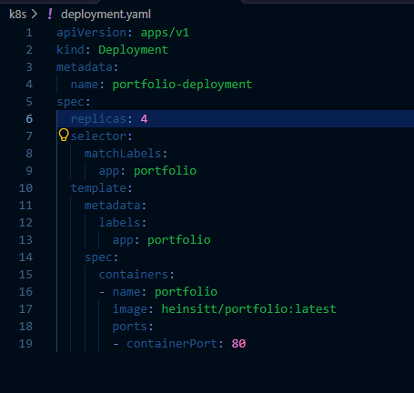
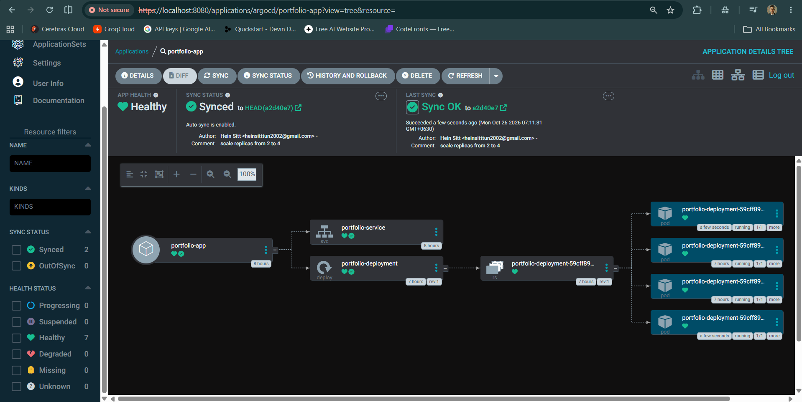

# 🚀 End-to-End GitOps CD Pipeline with Kubernetes & Argo CD

This project showcases an automated GitOps Continuous Deployment (CD) pipeline for a containerized Portfolio Web Application using **Docker**, **Kubernetes (Docker Desktop)**, **GitHub**, and **Argo CD**.

---

## 🏛️ Lab Overview & Architecture

---

## 🛠️ Tech Stack & Tools
- **Containerization:** Docker & Docker Hub
- **Orchestration:** Kubernetes
- **GitOps CD Engine:** Argo CD
- **Version Control:** GitHub
- **Environment:** Local K8s Cluster (Docker Desktop / WSL2 Ubuntu)

---

## 🏗️ Architecture & GitOps Workflow

1. **Build & Push:** Web application is containerized with Docker and pushed to Docker Hub.
2. **Declarative Manifests:** Kubernetes deployment and service manifests are stored in the `k8s/` directory.
3. **Automated Sync:** Argo CD monitors the GitHub repository and automatically synchronizes cluster states whenever manifests are updated.

---

## 📸 Key Milestones & Proof of Concept

### 1. Argo CD Automated Deployment & Health Status
Argo CD automatically synced and deployed the manifests into the local Kubernetes cluster.


### 2. Live Scaling Test (GitOps in Action)
Tested GitOps capability by updating `replicas: 2` to `replicas: 4` in `k8s/deployment.yaml`. Argo CD immediately detected the Git commit and scaled the application pods accordingly without manual cluster intervention.



### 3. Application Verification
Verified the application pods and nodeport services via `kubectl` and accessed the live app via Port-Forwarding.
```bash
kubectl get pods
kubectl get svc
kubectl port-forward svc/portfolio-service 8081:80